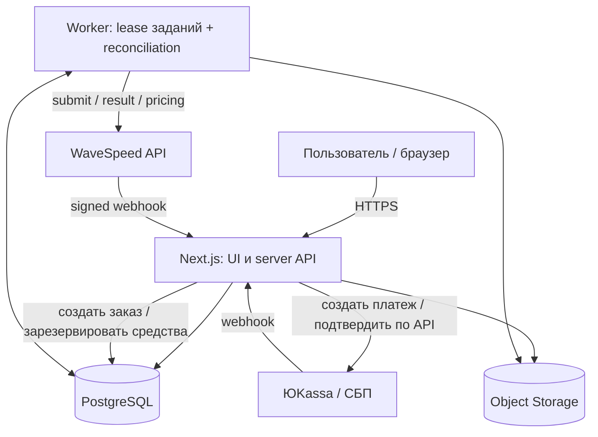
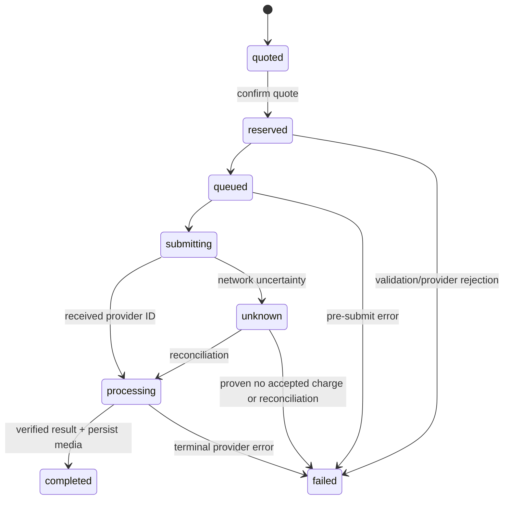

# Архитектура MVP

## Выбор

Модульный монолит: Next.js App Router (UI + API) + PostgreSQL + один worker для асинхронных задач. Развёртывание — Docker Compose, без Redis/Kafka/Kubernetes на старте. WaveSpeed — единственный провайдер первого релиза. Сервис проектируется так, чтобы адаптер другого провайдера добавить позднее.

## Контекст

Важно: диаграмма показывает целевую архитектуру M2–M3, а не уже реализованные модули. Текущий код — M0, демонстрационный интерфейс.

## Границы ответственности

- UI: каталог, параметризированные формы, загрузка, прозрачное состояние заказа.
- API: auth, server-side input validation, quotes, orders, payments, status, download authorization.
- Domain: AppCatalog, QuoteService, WalletLedger, GenerationJob, ProviderAdapter, PaymentGateway, MediaStorage.
- Worker: claim задач из БД с lease, ограничение конкурентности, отправка, проверка статусов, сохранение output и сверка.
- PostgreSQL: источник правды по заказам, деньгам, статусам, idempotency keys и audit.
- Object storage: временные входы/выходы, доступ через авторизованные короткоживущие URL.

## Флоу платной генерации

1. UI запрашивает server-side quote для выбранного App + параметров. Backend проверяет модель и price API, курс/наценку, лимиты; quote содержит expiry, hash параметров, итоговые копейки.
2. Авторизованный клиент подтверждает quote и передаёт idempotency key.
3. В ОДНОЙ транзакции: создаётся заказ, проверяется доступный баланс, резервируется сумма, фиксируются ledger entry и outbox событие. Повтор с тем же ключом возвращает тот же заказ.
4. Worker забирает задание с DB lease, проверяет budget и отправляет POST провайдеру. Платный POST **не повторяем вслепую**, если ответ потерян: статус UNKNOWN_SUBMISSION, reconciliation по истории/провайдеру.
5. Успешный signed webhook или безопасный GET обновляет статус с защитой от дублей. Worker сохраняет outputs к нам, лишь после подтверждения доступности выдаёт пользователю.
6. При success reserve -> capture; при подтверждённой технической ошибке reserve -> release. Непонятная ситуация остаётся на ручной/автоматической сверке, а не мгновенном необоснованном возврате.
7. Журнал денег и обработка событий идемпотентны; критические переходы выполняются под блокировками БД.

## State machine

Status 'unknown' не считается failed и не допускает повторную платную отправку без расследования. Webhooks могут приходить не по порядку — terminal status нельзя перезаписать старым 'processing'.

## Интеграционные заметки (документировано на 2026-11-06)

WaveSpeed:
- Submit: POST https://api.wavespeed.ai/api/v3/{model_id}
- Result: GET https://api.wavespeed.ai/api/v3/predictions/{id}/result
- Для нового продакшен-вызова: query parameter `standard_webhook`, подпись в соответствии с Standard Webhooks.
- Не отправлять `enable_sync_mode=true` с webhook.
- У разных моделей разные input schemas. Каждый App требует собственный adapter, whitelist полей, лимиты и проверку медиа.
- URL outputs временные; скачивать в наше storage.

ЮKassa:
- Server-to-server создание платежа и проверка финального состояния.
- Webhook рассматривается как сигнал к проверке платежа по API, а не как безусловное право зачислить средства.
- Идемпотентность по payment ID и ключу операции.

Документация:
- https://wavespeed.ai/docs/submit-task
- https://wavespeed.ai/docs/what-are-predictions
- https://wavespeed.ai/docs/how-to-use-webhooks
- https://yookassa.ru/developers/using-api/webhooks

## Не вводим преждевременно

Тонкую абстракцию для 10 провайдеров, event bus, отдельные микросервисы, AI-агент для управления оплатами, CDN со сложным правилами. При росте добавляем компоненты по измеримой нагрузке.
